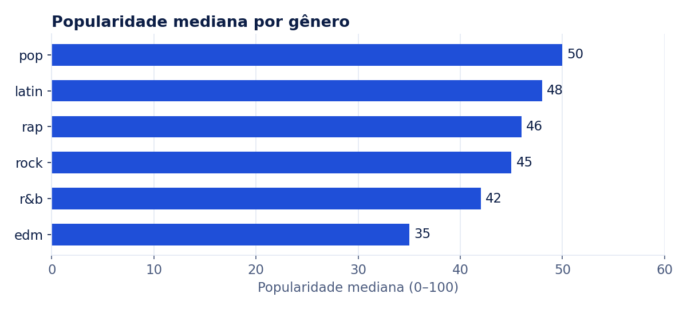
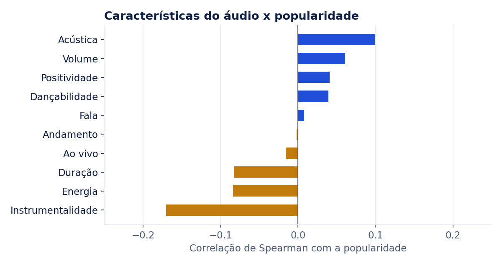

# O que faz uma música ser popular no Spotify?

   

**[Ver o dashboard interativo](https://bishoppython.github.io/spotify-popularidade-analytics/)**

## 💡 Resumo do projeto

Analisei 28.356 faixas de playlists do Spotify para entender o que separa uma música popular das demais. O resultado contraria a intuição comum: **as características do áudio quase não explicam a popularidade** (nenhuma passa de |ρ| = 0,17). O que mais separa sucesso de fracasso é o **subgênero**: a mediana vai de 65 em *post-teen pop* a 27 em *progressive electro house*.

## ❓ Problema de negócio / contexto

Imagine o time de curadoria de uma gravadora ou de um serviço de playlists. Ele precisa decidir onde investir divulgação e espaço nas playlists, e quer saber:

1. Quais gêneros concentram as músicas mais populares?
2. Características do áudio, como dançabilidade e energia, ajudam a prever o sucesso de uma faixa?
3. Como a época de lançamento de uma faixa se relaciona com a popularidade dela hoje?

Escolher pelo "feeling" custa caro: uma faixa sem tração ocupa o lugar de outra que poderia performar.

## 📊 Dados utilizados

| Item | Detalhe |
|---|---|
| Fonte | [TidyTuesday 2020-01-21](https://github.com/rfordatascience/tidytuesday/tree/master/data/2020/2020-01-21), coletado com o pacote `spotifyr` |
| Volume | 32.833 entradas de playlists, 28.356 faixas únicas, 6 gêneros e 24 subgêneros |
| Período | Faixas lançadas de 1957 a janeiro de 2020; popularidade medida em janeiro de 2020 |
| Variáveis | Popularidade (0–100), gênero/subgênero da playlist e 12 características de áudio da API do Spotify |

**Tratamentos necessários:**

- **Duplicatas:** a mesma faixa aparece em várias playlists. Reduzi os dados para **uma linha por faixa**, removendo 4.477 repetições. Sem isso, faixas presentes em muitas playlists teriam peso maior na análise.
- **Datas com precisão variável:** algumas datas de lançamento vêm só com o ano (1.855 entradas) ou com ano e mês (31). Padronizei todas como data e guardei a precisão original em uma coluna.
- **Faixas com popularidade zero:** são 2.620 faixas (9,2%), em geral sem histórico de reprodução. Elas ficam nas contagens, mas saem do cálculo de correlação para não distorcê-lo.

## 🛠️ Metodologia e ferramentas

```
download + checksum  →  staging (SQL)  →  dim_track (1 linha/faixa)  →  marts  →  análise  →  dashboard
      Python               DuckDB              DuckDB                    DuckDB     pandas     Plotly
```

1. **Ingestão reprodutível** (`src/ingest.py`): baixa o CSV e confere o SHA-256. Se a fonte mudar, o pipeline para em vez de produzir números diferentes sem aviso.
2. **Modelagem em SQL** (`sql/`): staging com tipagem; uma dimensão de faixas no grão correto; uma tabela-ponte faixa × gênero; e marts por gênero e década.
3. **Análise** (`src/analyze.py`): mediana e taxa de hits (popularidade ≥ 70) por gênero e subgênero; correlação de **Spearman**, escolhida por ser robusta a outliers e a relações não lineares; e perfil mediano de hits contra o das demais faixas.
4. **Qualidade de dados** (`tests/`): 13 testes com pytest cobrindo unicidade do grão, ausência de nulos, faixas válidas para popularidade e características, e reconciliação entre staging e dimensão.
5. **Entrega:** dashboard estático em `docs/index.html`, publicado no GitHub Pages, e CI no GitHub Actions rodando o pipeline completo a cada push.

**Ferramentas:** Python, SQL (DuckDB), pandas, Plotly, Matplotlib, pytest, GitHub Actions.

## 📈 Principais insights e resultados

### 1. Pop e latin lideram; EDM fica para trás



| Gênero | Faixas | Popularidade mediana | Taxa de hits |
|---|---:|---:|---:|
| pop | 5.132 | 50 | 18,4% |
| latin | 4.641 | 48 | 15,5% |
| rap | 5.486 | 46 | 9,6% |
| rock | 4.451 | 45 | 10,5% |
| r&b | 5.138 | 42 | 13,0% |
| edm | 5.537 | 35 | 6,4% |

No pop, uma faixa tem quase **3 vezes mais chance** de ser hit do que no EDM.

### 2. As características do áudio quase não explicam o sucesso



- A relação mais forte é **negativa**: instrumentalidade (ρ = −0,17). Faixas sem vocal tendem a ser menos populares.
- **Dançabilidade (0,04) e energia (−0,08)**, as primeiras apostas de muita gente, praticamente não têm relação com a popularidade.
- Comparando medianas, os hits são um pouco **mais acústicos** (0,118 contra 0,081) e **menos enérgicos** (0,690 contra 0,721) que as demais faixas. São diferenças pequenas.

### 3. O subgênero separa mais do que o gênero

| Melhores subgêneros | Mediana | Piores subgêneros | Mediana |
|---|---:|---|---:|
| post-teen pop (pop) | 65 | progressive electro house (edm) | 27 |
| hip pop (r&b) | 60 | new jack swing (r&b) | 29 |
| permanent wave (rock) | 59 | big room (edm) | 33 |
| reggaeton (latin) | 59 | neo soul (r&b) | 34 |
| dance pop (pop) | 56 | electro house (edm) | 38 |

O R&B aparece nos dois extremos: *hip pop* tem mediana 60 e *new jack swing*, 29. Uma decisão tomada só pelo gênero esconde essa diferença.

### 4. Clássicos que sobrevivem nas playlists vão bem

| Década | Faixas | Mediana |
|---|---:|---:|
| 1960 | 132 | 56,5 |
| 1970 | 783 | 50 |
| 1980 | 1.090 | 47 |
| 1990 | 2.081 | 42 |
| 2000 | 3.807 | 34 |
| 2010 | 19.834 | 43 |

Faixas antigas que ainda estão nas playlists têm mediana alta. É um **viés de sobrevivência**: só os clássicos que continuam sendo ouvidos chegam ao dataset. Os anos 2000 formam o "vale" do catálogo.

### Recomendações

1. **Não use as características de áudio como critério principal de seleção.** O sinal é fraco. Para prever sucesso, é preciso incluir variáveis de artista, histórico e divulgação.
2. **Planeje por subgênero, não por gênero.** Priorize *post-teen pop*, *hip pop*, *reggaeton* e *permanent wave*, e revise o espaço dado a *progressive electro house* e *big room*.
3. **Use o catálogo antigo.** Clássicos dos anos 60 a 80 têm bom desempenho e custam menos para promover que lançamentos.
4. **Próximo passo:** um modelo que combine artista e subgênero (o tema do nível prata).

### Limitações

- A popularidade é uma **foto de janeiro de 2020**. A evolução de um artista ao longo do tempo não pode ser medida com esses dados; a análise por década mede a idade das faixas, não a trajetória delas.
- O dataset **não tem região**, então a pergunta sobre diferenças regionais fica fora do escopo.
- A amostra vem de **playlists**, não do catálogo completo do Spotify.

## 🚀 Como executar o projeto

**Pré-requisitos:** Python 3.11+ e `make`.

```bash
git clone https://github.com/bishoppython/spotify-popularidade-analytics.git
cd spotify-popularidade-analytics
pip install -r requirements.txt
make all        # baixa, transforma, analisa, gera o dashboard e as imagens, e roda os testes
```

O dashboard fica em `docs/index.html`; basta abrir o arquivo no navegador. Cada etapa também pode ser rodada separadamente: `make ingest`, `make transform`, `make analyze`, `make dashboard`, `make figures` e `make test`.

**Publicar o dashboard:** em *Settings › Pages*, escolha a branch `main` e a pasta `/docs`.

```
├── sql/               modelos SQL (staging, dimensão, marts)
├── src/               ingestão, transformação, análise e dashboard
├── tests/             testes de qualidade de dados
├── docs/              dashboard publicado e imagens do README
└── outputs/           métricas geradas (metrics.json e CSVs)
```

## 🤝 Contato

**Anderson Bispo** · Engenheiro de Dados Sênior
[LinkedIn](https://www.linkedin.com/in/anderson-bishopx/) · [Portfólio](https://bishoppython.github.io) · [GitHub](https://github.com/bishoppython)
